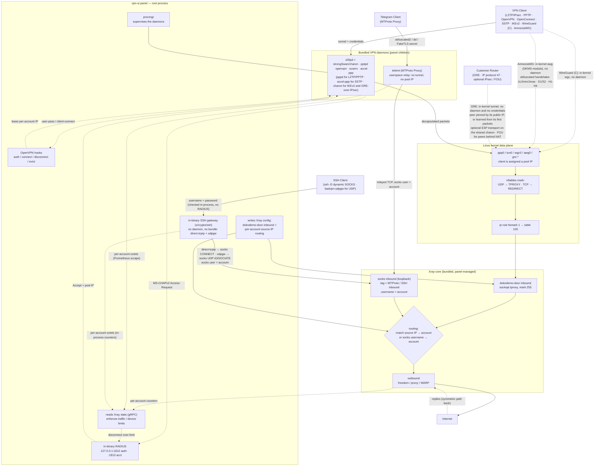
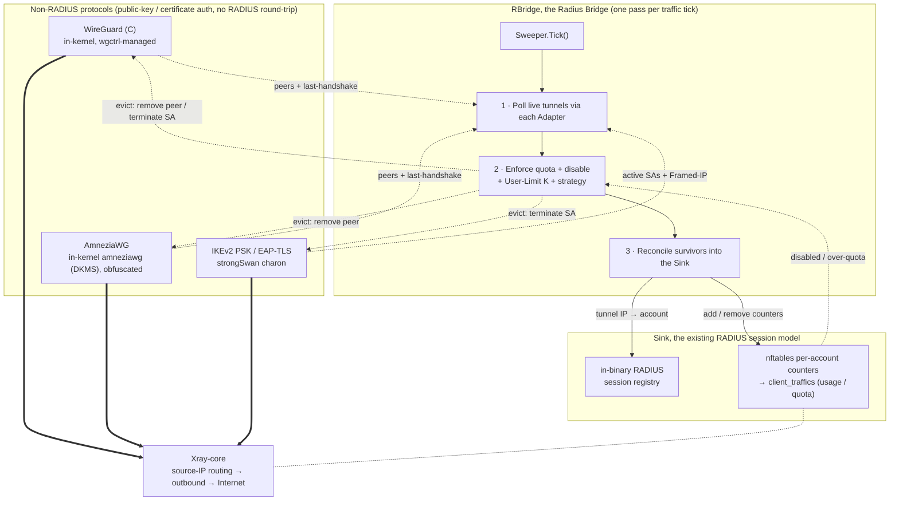

# Protocol architecture

## Stable v1.0.0 control and presentation layers

Central accounts own credentials, quota, expiry and subscription identity. Memberships and groups determine inbound access; role/owner policy bounds every operation. Jobs project changes into native and daemon-backed data paths. Dedicated location agents receive authenticated snapshots and return cumulative, sequenced counters. Nodes poll every second; host diagnostics normally refresh every five seconds. A lost 90-second management lease stops their data plane. See [node architecture and limits](NODES.md).

HTML templates use thirteen bounded language-specific renderers. Middleware resolves cookie/header dialects per request; panel and subscription renders no longer depend on a concurrently mutable global language. The built-in management Telegram bot uses its configured language. The separate sales bot currently uses Persian; see [sales bot](../telegram-bot/README-SALES-BOT.md). Shared component/calendar assets are local. See [translation checks](TRANSLATIONS.md).

The diagrams below explain implementations, not certification of every protocol/kernel/distribution combination. The cplane proposal remains historical research. For current UI operations use the [panel guide](PANEL-GUIDE.md).

These diagrams explain representative data/control paths, not a complete protocol inventory or
live-connectivity certification. GRE also uses a managed interface and nftables; see
[its service](../web/service/gre.go). Host prerequisites are listed in
[the offline guide](OFFLINE-INSTALL.md).

## How the New Protocols Interact with Xray-core

## How RBridge Handles Non-RADIUS Protocols

WireGuard (C), AmneziaWG and the IKEv2 **PSK** / **EAP-TLS** modes authenticate with a public key or
a certificate, so they never make a RADIUS round-trip. On their own they would get no session
record, no traffic accounting, and no **User Limit** enforcement. **RBridge** (Radius Bridge) closes
that gap: once per traffic tick its **Sweeper** polls each protocol's live tunnels, enforces quota,
disable, and the per-account **User Limit** K (evicting the losers), then reconciles the survivors
into the very same in-binary **RADIUS** session registry and **nftables** accounting the RADIUS
protocols already use. A key-based protocol therefore behaves identically for usage, quota, and
device limits, and egresses through the same Xray **dokodemo-door** data plane.

For the two key-based tunnel protocols, **WireGuard (C)** and **AmneziaWG**, a **User Limit** of K
provisions K device slots per account: K keypairs, K configs and K distinct tunnel IPs, one config
per device. That is the same model the commercial providers use, and it is what makes a single
account usable on a phone, a laptop and a router at once without the devices fighting over one key.

## Dedicated nodes

`cmd/vpn-ui-node` reuses the data-plane runtime without panel/admin HTTP listeners.
`nodewire` is the versioned enrollment/snapshot/report protocol; `nodeagent` persists
report delivery and polls central HTTPS. `web/service/node.go` scopes assignments
and commits cumulative high-water marks with shared billing in one transaction.
`web/service/node_worker.go` projects snapshots without resetting local meters.
An inbound `node_id` of zero denotes the central server; runtime queries exclude
remote inbounds. See [node operation and accounting limits](NODES.md).
